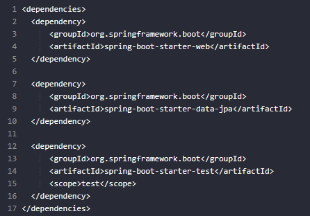
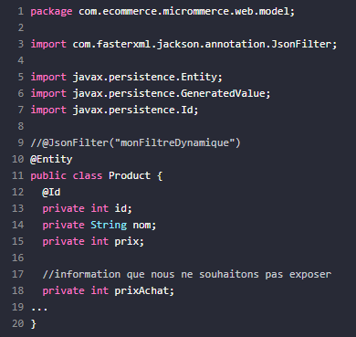
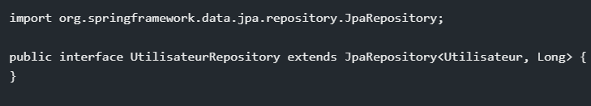

# C'est quoi ?
Spring Data JPA est un module de Spring, sert à grandement faciliter l'accès aux bases de données relationnelles.
Acronyme de "Java Persistence API"

# Comment ça fonctionne ?
On peut créer des requêtes avec :
- L'annotation @Query -> requêtes natives
- Construire la requête à partir du nom de la méthode -> requêtes dérivées
- Spécifications -> requêtes dynamiques

Il faut d'abord importer les dépendances nécessaires dans le pom.xml du projet,
 spring-boot-starter-data-jpa s'en charge

 

Il s'agit désormais de transformer des classes en entité gérée par JPA afin de pouvoir en générer des tables.
@Entity transforme la classe, 
@Id et @GeneratedValue permet d'identifier un attribut id en tant que clé unique
@Table spécifie le nom de la table de la base de données
@Column permet de modifier la configuration d'un colonne
@Transient pour un champ que l'on ne veut pas enregistrer dans la base de données

  

Il faut désormais créer un repository, une interface permettant d'opérer sur les tables créées, échangeant du code Java aux données.
Cette interface dispose de différentes méthodes pour en gérer les données

 

 save() permet d'ajouter une ligne ou la mettre à jour

findById() récupère une entité par son id.
findAll() retourne toutes les entités d'une base de données.
deleteById() supprime une entité de la base de données par son id.
Sort.by() permet de trier les entités d'une classe par un champ spécifié.

Davantage requêtes simples avec noms de méthodes ou requêtes personnalisées existent pour plus de contrôle des données via JPA.

